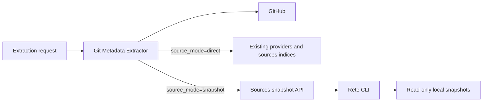

# Choose direct sources or local snapshots

Set `source_mode` per extraction to choose where scholarly enrichment reads its
data. The default, `direct`, preserves the existing provider setup, including
the sources service's configured indices. `snapshot` uses read-only local
[Rete](https://github.com/caviri/rete) files through **open-pulse-sources**.
GitHub repository and account collection remains live in either mode.



GME contains HTTP adapters, not Rete or database files. Sources owns the query
mappings, input validation, authentication and bounded query processes. This
initial backend reads local files; remote HTTP snapshots are not configured yet.

## Make an extraction

For `GET /v2/extract`, add `source_mode=snapshot` alongside the existing URL and
runtime query parameters. For `POST /v2/extract`, include the field in the job body:

```json
{
  "source_url": "https://github.com/sdsc-ordes/gimie",
  "agent_runtime": "rule_based",
  "source_mode": "snapshot",
  "include_run_report": true
}
```

Use `source_mode=direct` to select the existing providers. Omit the field to use
`V2_SOURCE_MODE`, which defaults to `direct`. The mode is fixed when an async job
is submitted. Invalid values return HTTP 422. Concurrent requests can use
different modes without changing process environment variables.

Snapshot mode is strict: an unmapped lookup or unavailable file produces a
warning and no live scholarly fallback. Web search, Selenium fetching, live
OpenAlex DOI discovery, Wikipedia tagging and package-registry discovery are
disabled. LLM/hybrid reasoning remains available, but snapshot mode does not
turn model-generated claims into verified database facts. Link verification is
skipped without pruning links that could not be checked.

## Configure sources in Docker

Build the paired sources checkout from `config/services/sources.lock.json`.
Its image includes the pinned Rete CLI. Copy its `config/snapshots.yaml` to an
operator-owned location, and update the file paths and export versions. Paths
must be container paths under the read-only mount; don't copy index files into
GME or send paths/SPARQL in extraction requests.

```bash
export SNAPSHOT_DATA_DIR=/path/to/existing/rete/files
export SNAPSHOT_REGISTRY_FILE=/path/to/local-snapshots.yaml
docker compose --env-file .env \
  -f tools/deploy/docker-compose.yml \
  -f tools/deploy/docker-compose.snapshots.yml up -d --build
```

On Windows, use absolute host paths such as `D:/pro/rete/data` in the environment
variables. Set each registry `path` relative to the mount root, for example
`/snapshots/epfl-infoscience/epfl-infoscience.rete`. The override refuses to create
missing host directories. Only sources receives these mounts.

The snapshot endpoints use the same Bearer token as the sources API:

- `GET /v2/snapshots/manifest`: available datasets, supported operations and cache fingerprint.
- `POST /v2/snapshots/{provider}/{method}`: typed provider arguments, normalized results and dataset identities.

See [the sources snapshot guide](https://github.com/sdsc-ordes/open-pulse-sources/blob/feat/2026-11-refactor/docs/snapshots.md)
for registry editing and query limits. The implementation is local until that
branch is published; the same guide is in `dev/open-pulse-sources/docs/snapshots.md`.

## Current coverage

| Source | Supported lookups | Limits |
| --- | --- | --- |
| ROR | Organization by ROR ID; name search; lexical ROR RAG search | RAG search is worldwide, without filters or reranking |
| ORCID | Person by ORCID iD; exact name search | Solr-style queries are unsupported; broad searches may time out on large files |
| Infoscience | People, organizational units and publications by text | Depends on fields present in the local export |
| Other sources / extractor operations | No mappings initially | Explicit unsupported result; no silent live fallback |

Add query mappings in the sources YAML registry. New input contracts or result
shapes also need a sources adapter and tests; the extractor's ontology mappings
remain separate from these retrieval mappings.

## Compare and inspect

Benchmark profiles accept `source_mode: snapshot`. The benchmark CLI can
override all selected profiles with `--source-mode snapshot` or
`--source-mode direct`; use separate output directories for the comparison.
`--providers live` still selects real GitHub collection. Include run reports
to retain the dataset identities actually queried.

Responses report `source_mode`. Optional run reports include `source_snapshots`.
When substrate output is enabled, its `pulse:SourceSnapshot` nodes identify the
observed dataset revision, not merely the sources software build. The registry
version plus local file size, modification time and header digest distinguish
exports; this is a change detector, not a checksum of the entire file. Treat
published snapshots as immutable and give each export an explicit version.

Pipeline cache keys include mode and the current manifest fingerprint. Missing
manifests, identity changes and incomplete lookups prevent successful cache
reuse/storage. Individual LLM verdict caches are disabled in snapshot mode
because those historical packets do not retain queried dataset identities.
A pipeline cache hit retains the original graph provenance and reports that no
new extraction was performed.
